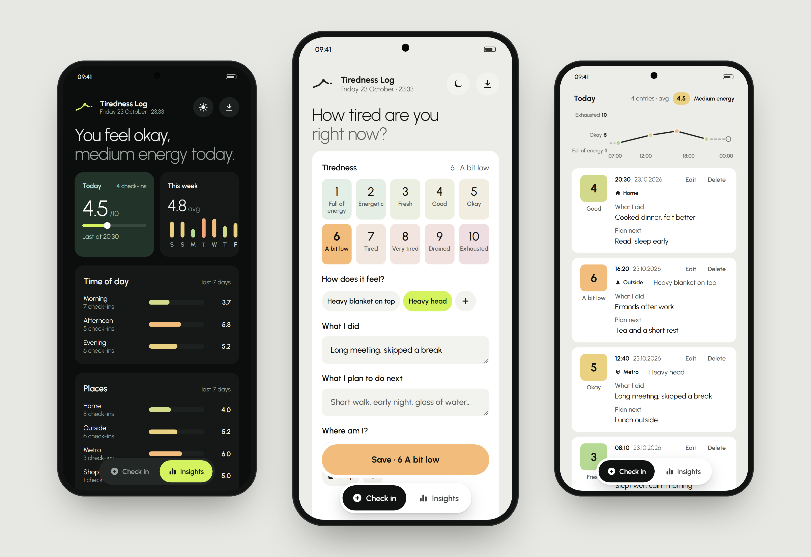

# Tiredness Tracker

A phone web app for logging how tired I am during the day: a 1–10 level, how it feels, what I did, what I plan next and where I am. Insights show the day as a line chart and the week by time of day, place and feeling. Entries export as a PDF report or CSV.

## Try it

Open `tiredness-log.html` in a browser. Opened this way, entries are saved only in that browser on that device.

## Privacy

This repository contains the app, not anyone's data. Entries are never stored in the code; images in `portfolio/` use made-up sample entries.

## Folder

| Path | What |
|---|---|
| `tiredness-log.html` | The whole app in one file |
| `tiredness-log-icon.png` | App icon |
| `portfolio/mockups/` | Mockup images and the PDF export page |
| `portfolio/phones/`, `portfolio/screens/` | Single screens, framed and unframed |
| `portfolio/mockups.html` | Renders the mockup images from the real app with sample data |
